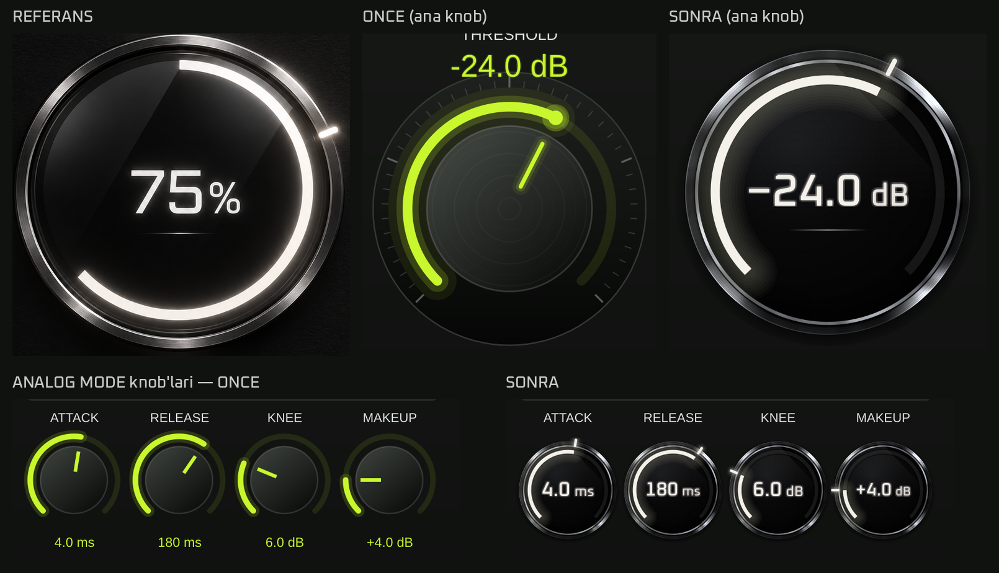
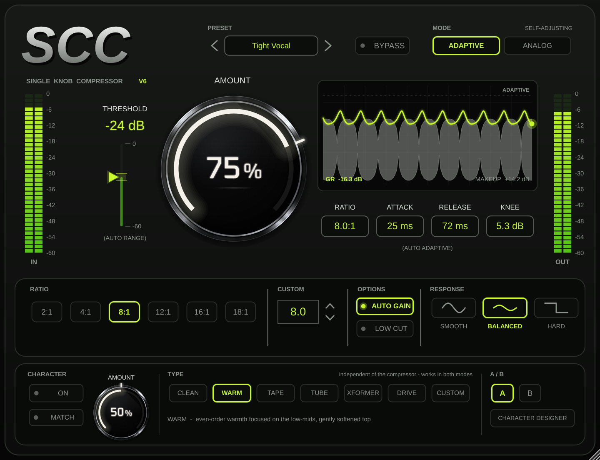
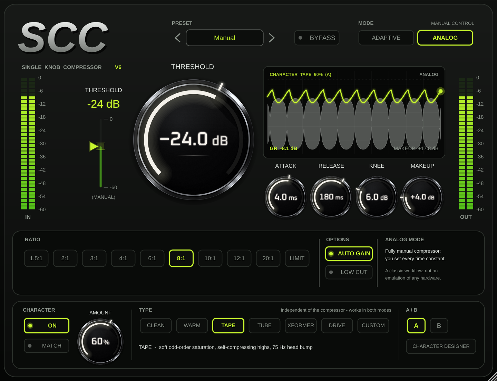
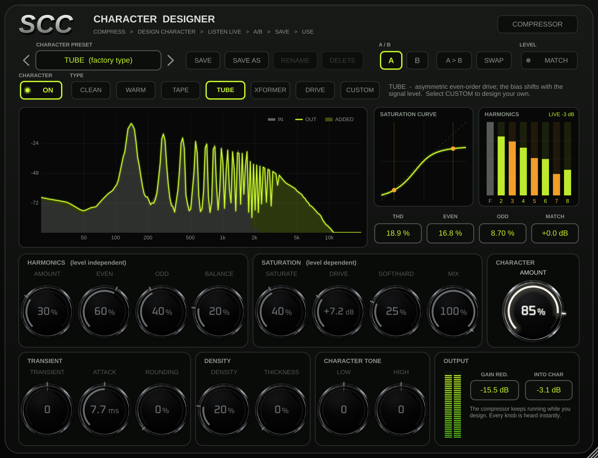
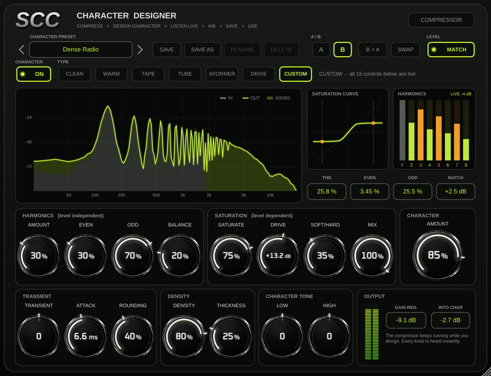

# SCC V6 – Single Knob Compressor + Character Engine

> **Compress Your Way. Create Your Own Character.**
> COMPRESS → DESIGN CHARACTER → LISTEN LIVE → A/B → SAVE → USE

Sese göre kendini ayarlayan vokal kompresörü (V5), tamamen manuel bir kompresör modu ve
kompresyondan bağımsız bir karakter (renk) motoruyla birlikte.
Formatlar: **VST3**, **AU** (sadece macOS), **Standalone**.

## V6'da yeni

| | |
|---|---|
| **ANALOG MODE** | Tamamen manuel kompresör: threshold, ratio (1.5:1 … 20:1, LIMIT), attack, release, knee, makeup. |
| **CHARACTER ENGINE** | Kompresyondan bağımsız renk katmanı. 6 hazır tip + kendi tasarladığın CUSTOM. Her iki modda çalışır. |
| **CHARACTER DESIGNER** | 15 kontrollü ayrı ekran: harmonikler, doygunluk, vuruş, yoğunluk, ton. Her knob gerçek sese anında yansır. |
| **Analiz** | Gerçek zamanlı spektrum (giriş / çıkış / eklenen içerik), harmonik imza, doygunluk eğrisi. |
| **A/B** | İki karakter slotu; anında geçiş, kopyala, değiştir, isteğe bağlı seviye eşitleme (MATCH). |
| **Karakter presetleri** | 12 fabrika karakteri + kendi kaydettiklerin (kaydet / yükle / yeniden adlandır / sil). |

**V5 korunur:** V5'in altı parametresi (kimlik, aralık, varsayılan), adaptif attack/release algoritması,
dedektör, auto gain, low cut ve hazır ayarlar aynen duruyor. Yeni özellikler varsayılan olarak kapalı;
V5 ile kaydedilmiş bir oturum V6'da açıldığında aynı sesi verir (testle doğrulandı: en büyük fark 3·10⁻⁸).

## Derleme

Gerekenler: **CMake 3.22+** ve bir C++17 derleyici.

- macOS: `xcode-select --install` ve `brew install cmake`
- Windows: Visual Studio 2022 ("Desktop development with C++") ve CMake
- Linux: `sudo apt install build-essential cmake libasound2-dev libx11-dev libxrandr-dev libxinerama-dev libxcursor-dev libfreetype-dev libfontconfig1-dev libgl1-mesa-dev`

Proje klasörünün içinde:

```bash
# macOS / Linux
cmake -B build -DCMAKE_BUILD_TYPE=Release
cmake --build build --config Release -j8

# Windows (Developer PowerShell)
cmake -B build -G "Visual Studio 17 2022"
cmake --build build --config Release
```

İlk derlemede JUCE 8.0.6 otomatik indirilir (internet gerekir, 5–10 dk sürebilir).
Elinde JUCE varsa: `cmake -B build -DSCC_JUCE_PATH=/yol/JUCE`

Çıktılar `build/SCC_artefacts/Release/` altında:

| Format | Yer |
|---|---|
| VST3 | `VST3/SCC.vst3` |
| AU (macOS) | `AU/SCC.component` |
| Standalone | `Standalone/SCC.app` (veya `.exe`) |

macOS/Linux'ta derleme bitince eklenti otomatik plugin klasörüne kopyalanır
(`~/Library/Audio/Plug-Ins/VST3`, `.../Components`). DAW'ı yeniden başlat / plugin taraması yap.
Windows'ta `SCC.vst3` klasörünü elle `C:\Program Files\Common Files\VST3` içine kopyala.
macOS "doğrulanamadı" derse: Sistem Ayarları → Gizlilik ve Güvenlik → "Yine de izin ver".

Plugin kimliği V5 ile aynıdır (`Sccx` / `Scc1`, `com.sccaudio.scc`): V6, V5'in yerine geçer ve V5 oturumlarını açar.

## Knob görünümü

Bütün knob'lar (ana knob, Analog Mode, Character Designer) tek bir çizim koduyla çizilir:
fırçalanmış çelik çerçeve, kara cam kubbe, parlayan beyaz yay ve çerçeveyi aşan kapsül işaretçi.
Değer, kubbenin ortasında gömülü **Oxanium** yazı tipiyle yazılır (rakamlar eşit genişliktedir, değer değişirken titremez).



- **Etkileşim koduna dokunulmadı:** sürükleme, çift tık, tekerlek JUCE `Slider`'ın kendi davranışıdır. Yeni olan tek şey, fare üstündeyken çerçevenin parlamasıdır.
- **Kilitli** (tip seçiliyken Designer knob'ları) knob'lar gri yay ve gri değerle solar, yine okunur.
- **Iki kutuplu** knob'larda (TRANSIENT, LOW, HIGH) yay 12 yönünden başlar ve orta çentik görünür.
- Çerçeve + cam + iz bandı bir kez, ekranın gerçek piksel çözünürlüğünde (1x / 2x) çizilip saklanır; değer
  değişince yalnızca yay, işaretçi ve yazı yeniden çizilir (ölçülen: küçük knob ≈ 0.7 ms, ana knob ≈ 1.7 ms).

Ayar noktaları (`Source/SCCKnobStyle.h`):

| Ne | Nerede |
|---|---|
| Yay / işaretçi / yazı rengi (varsayılan sıcak beyaz). Eski neon yeşil için `= kNeon` yap | `kKnobLight` |
| Çerçeve, yay, işaretçi kalınlıkları ve oranları | `struct Geo` |
| Çeliğin ışık dağılımı, fırça dokusu | `makeBezelImage` |
| Yay çevresindeki parlama | `KnobRenderer::draw` içindeki "yay parlaması" döngüsü |
| Değerin knob'un altında yazılması (eski düzen) | `LabeledKnob::setValueInside (false)` |

Yazı tipi: **Oxanium** (Medium, SIL Open Font License 1.1). `Source/SCCKnobFont.h` içine bayt dizisi olarak
gömülüdür; ek dosya ya da BinaryData gerekmez, yalnızca `Source` klasörünü kendi projene eklemek yeter.
Lisans metni: `Resources/OFL-Oxanium.txt` (plugin'i dağıtırsan lisans metnini de birlikte ver).

## Ekranlar

| ADAPTIVE | ANALOG |
|---|---|
|  |  |

| Character Designer – hazır tip | Character Designer – CUSTOM |
|---|---|
|  |  |

*(Görüntüler test programının ürettiği gerçek arayüz çıktılarıdır; Linux yazı tipiyle. macOS / Windows'ta yazı tipi farklı görünür.)*

**Ana ekran** (960 × 736, pencere 600–1920 piksel arasında büyütülebilir; boyut hatırlanır)

- üst: kompresör PRESET'i, BYPASS, **MODE** (ADAPTIVE / ANALOG)
- orta: IN / OUT metreleri, threshold göstergesi (diz şeridiyle), ana knob (değeri kubbenin ortasında), dalga formu + gain reduction
- alt çubuk: ratio ve seçenekler (moda göre değişir)
- en alt: **CHARACTER** şeridi – ON, AMOUNT, tip, MATCH, A/B, CHARACTER DESIGNER

**Character Designer** (aynı pencerede ayrı sayfa; COMPRESSOR düğmesiyle geri dönülür)

- üst: karakter preseti (◂ ▸, listeden seç, SAVE / SAVE AS / RENAME / DELETE), A / B, kopyala, SWAP, MATCH
- orta: spektrum, doygunluk eğrisi, harmonik imza, THD / EVEN / ODD / MATCH okumaları
- alt: 15 kontrol (5 grup) + global CHARACTER AMOUNT; çıkış metresi ve gain reduction

## Kompresör

### ADAPTIVE (V5 – değişmedi)

**Tek knob (AMOUNT 0–100 %)** yalnızca threshold'u sürer: %0 → −1 dB, %100 → −32 dB (dB'de doğrusal).

**Attack / Release knob'dan bağımsızdır**, sinyalin dalga formuna göre sürekli ayarlanır.
Nominal değerler attack **20 ms**, release **100 ms**; sesin durumuna göre bunların çevresinde gezer
(sessizlikte tam 20 / 100'e döner). Ekrandaki kutular canlı değerleri gösterir.

- **Attack**: zirve, kısa vadeli ortalamadan çok yüksekse (keskin başlangıç, patlayıcı ünsüz) kısalır, ses oturup dolgunlaşınca uzar.
- **Release**: seviye hızlı dalgalanıyorsa (hece hece konuşma) kısalır, seviye durağansa (uzun nota) uzar. Pompalama olmaz.

**Ratio**: 2 / 4 / 8 / 12 / 16 / 18 tuşları veya CUSTOM kutusuna 1–100 arası istediğin değer.

**RESPONSE** (SMOOTH / BALANCED / HARD): diz (knee) genişliği ve adaptasyonun ne kadar hızlı olabileceği.
V5'te bu grubun adı "CHARACTER" idi; V6'da "Character" renk motorunun adı olduğu için **RESPONSE** oldu.
Parametre kimliği (`mode`) aynı.

**Diz (knee)** hem RESPONSE'a hem knob'a bağlıdır; knob arttıkça diz genişler:

| Knob | Smooth | Balanced | Hard |
|---|---|---|---|
| %0 | 4.2 dB | 2.1 dB | 0.5 dB |
| %25 | 7.2 dB | 3.6 dB | 0.9 dB |
| %50 | 9.0 dB | 4.5 dB | 1.1 dB |
| %75 | 10.6 dB | 5.3 dB | 1.3 dB |
| %100 | 12.0 dB | 6.0 dB | 1.5 dB |

**PRESET** (üst çubuk): 8 kompresör hazır ayarı (Default, Light Touch, Natural Vocal, Smooth Control, Tight Vocal,
Radio Rap, Full Smooth, Max Squash). AMOUNT, RATIO ve RESPONSE'u ayarlar; seçilince ADAPTIVE moda dönülür.
Karaktere dokunmaz.

### ANALOG MODE (yeni)

Klasik, elle ayarlanan kompresör iş akışı. Adaptif kararlar devre dışıdır; her şeyi sen belirlersin.
**Bir donanımın devre emülasyonu değildir ve öyle bir iddia taşımaz** (arayüzde de yazar).

| Kontrol | Aralık |
|---|---|
| THRESHOLD (ana knob) | −60 … 0 dB |
| RATIO | 1.5:1, 2:1, 3:1, 4:1, 6:1, 8:1, 10:1, 12:1, 20:1, LIMIT |
| ATTACK | 0.1 … 100 ms (logaritmik) |
| RELEASE | 10 … 1000 ms (logaritmik) |
| KNEE | 0 … 24 dB |
| MAKEUP | 0 … 24 dB |

- Attack / release zaman sabitleri ayarlanan değerle birebir örtüşür (testte ölçülüyor).
- **AUTO GAIN** isteğe bağlıdır ve elle MAKEUP'a ek olarak çalışır. **LOW CUT** ve stereo bağlantı adaptif modla aynıdır.
- **Mod geçişi tıksızdır:** iki kompresör de sürekli çalışır ve kazançları arasında 15 ms'lik çapraz geçiş yapılır.
  Geri döndüğünde adaptif analiz ve auto gain "sıcak"tır.

### Ortak

**AUTO GAIN**: giriş ve çıkış enerjisini uzun vadede eşitler.
**LOW CUT**: yalnızca dedektör 100 Hz altını görmez; sesin kendisi değişmez.
**BYPASS**: yumuşak geçişli. Host'un kendi bypass düğmesi de buna bağlıdır. Bypass'tayken karakter motoru işlemci harcamaz.

## Character Engine

Kompresörden **sonra** çalışan, gain reduction'dan tamamen bağımsız renk katmanı.

- **ON / OFF** ve **AMOUNT (0–100 %)**: AMOUNT bütün karakter yoğunluğunu ölçekler.
  OFF'ta veya %0'da motor tamamen devre dışıdır: sinyal bit düzeyinde aynen geçer, işlemci harcanmaz.
- **MATCH**: karakterin çıkışını girişiyle aynı yüksekliğe getirir ("daha yüksek olan daha iyi duyulur" yanılgısı
  olmadan karşılaştırırsın). Seviye A ve B için ayrı ayrı öğrenilir ve hatırlanır: bir slota geri döndüğünde baştan
  öğrenilmez (ölçülen: geri dönüşün ilk yarım saniyesinde 0.7 dB içinde). Yeni bir ayarın seviyesi ~1 saniyede oturur.
- Dalga formu ekranının sol üstünde etkin karakter, sağ üstünde çalışma modu yazar.

### Tipler

Her tip farklı bir DSP yapısıdır (aynı eğriye farklı isim verilmiş değildir).
Birer **tasarımdır**; belirli bir donanımın emülasyonu olduklarını iddia etmezler.

| Tip | Yapı | Ölçülen imza (−12 dBFS, %100) |
|---|---|---|
| **CLEAN** | Doğrusal bölgeli tepe yuvarlayıcı. Dizin altında sinyal hiç değişmez. | dizin altında THD ≈ 0; yalnızca tepeler |
| **WARM** | Kaydırılmış asimetrik eğri; alt-orta vurgulanarak doyurulur, tizler hafifçe yumuşar. | 2. harmonik baskın; baslarda daha yoğun |
| **TAPE** | Simetrik yumuşak eğri; tizler vurgulanıp doyurulur, 75 Hz kafa tümseği, üst tiz kaybı. | yalnızca tek harmonikler; tizlerde ~2 kat THD |
| **TUBE** | İki eğimli asimetrik eğri + **dinamik bias**: çalışma noktası sinyal zarfıyla kayar. | 2. harmonik baskın; yüksek bölümden sonra H2 ~7 dB daha fazla |
| **TRANSFORMER** | Akı alanında doygunluk: sinyal "integre edilir", doyurulur, tersi uygulanır. | 3. harmonik baskın; 60 Hz'de 3 kHz'in ~7 katı THD |
| **DRIVE** | İki kademe: asimetrik yumuşak kat → sert kırpıcı; bas önceden sıkılaştırılır. | en agresif; güçlü üst harmonikler |
| **CUSTOM** | Character Designer zinciri (aşağıda). | senin tasarımın |

### Character Designer – 15 kontrol

Hepsi gerçek DSP parametresidir (her biri testte tek tek ölçülüyor) ve yalnızca **CUSTOM** tipinde sesi etkiler.
Değerler CHARACTER AMOUNT %100 içindir; AMOUNT hepsini birlikte ölçekler.

| Grup | Kontrol | Ne yapar |
|---|---|---|
| **HARMONICS** | AMOUNT | Üretilen harmoniklerin toplam seviyesi. |
| *(seviyeden bağımsız)* | EVEN | Çift harmonikler (2., 4.). |
| | ODD | Tek harmonikler (3., 5.). |
| | BALANCE | %0 = düşük dereceler (2./3.) … %100 = yüksek dereceler (4./5.). |
| **SATURATION** | SATURATE | Eğrinin bükülmeye başladığı seviye (yüksek = daha erken, daha çok). |
| *(seviyeye bağlı)* | DRIVE | Sinyalin eğriye ne kadar itildiği (0 … +24 dB, çıkış telafili). |
| | SOFT/HARD | Yumuşak diz ↔ sert kırpma. Sertte kırpma noktasına kadar ses tamamen temizdir. |
| | MIX | Doyurucunun kuru / ıslak karışımı. |
| **TRANSIENT** | TRANSIENT | − vuruşları yumuşatır, + öne çıkarır (seviyeden bağımsız). |
| | ATTACK | Vuruş penceresi: 1.5 ms (yalnızca "tık") … 40 ms (vuruşun gövdesi de). |
| | ROUNDING | Vuruş tepesini zarfa göre **doyurarak** yuvarlar; sürekli sese dokunmaz. |
| **DENSITY** | DENSITY | Yukarı kompresyon: sesin kendi seviyesinin altında kalan kısımlar yukarı taşınır. Dip gürültüsü yükseltilmez. |
| | THICKNESS | Yalnızca alt bandın (≲200 Hz) 2. ve 3. harmoniği: gövde kalınlığı. |
| **CHARACTER TONE** | LOW | Basların ne kadar doyacağı (+ kalın, − temiz / sıkı). |
| | HIGH | Tizlerin ne kadar doyacağı (+ yumuşak / "bant", − açık / temiz). |

Harmonik üreteci ile doyurucu bilerek **farklı** çalışır: üreteç Chebyshev polinomlarıyla seviyeden bağımsız,
tam olarak istenen harmoniği üretir; doyurucu klasik, seviyeye bağlı dalga şekillendiricidir.
CHARACTER TONE bir **EQ değildir**: doğrusal olmayan katların önünde bir bandı yükseltip arkasında tam tersini uygular;
doygunluk kapalıyken frekans tepkisi dümdüzdür (ölçülen sapma 0.0000 dB), yalnızca karakterin *hangi frekanslarda*
oluşacağı değişir.

Bir tip seçiliyken Designer knob'ları soluk ve kilitlidir (o an sesi etkilemedikleri için); CUSTOM'ı seçince açılırlar.

### Analiz (Designer ekranı)

Üçü de gerçek veriye dayanır:

- **Spektrum**: ses motorunun karakter katına *giren* (gri) ve *çıkan* (yeşil) gerçek sinyali. Aradaki dolgu karakterin
  **eklediği** içeriktir. Ses iş parçacığı yalnızca örnekleri kilitsiz bir tampona yazar; FFT arayüz iş parçacığında yapılır.
- **Harmonik imza**: ses yolundakiyle *aynı* motor sınıfının ayrı bir örneği 220 Hz'lik bir test sinüsüyle çalıştırılır
  ve çıkışın harmonikleri ölçülür. Temel (F) + 2.–8. harmonik; çiftler yeşil, tekler turuncu. Ses çalarken test seviyesi
  gerçek sinyal seviyesidir ("LIVE"), ses yokken −12 dBFS referans ("REF").
- **Doygunluk eğrisi**: ses işlemenin kullandığı statik eğri fonksiyonunun kendisi; turuncu noktalar sinyalin o anki tepe seviyesi.

### A/B

İki slot (A, B); her biri bir tip + Designer'ın 15 değerini tutar. Kompresör ayarları ve CHARACTER AMOUNT ortaktır,
yani yalnızca *karakter* karşılaştırılır.

- **A / B**: anında geçiş (otomasyona açık parametre). Tipler aynıysa değerler yumuşatılır, farklıysa 40 ms çapraz geçiş yapılır.
- **A > B / B > A**: etkin slotu diğerine kopyalar. **SWAP**: yer değiştirir.
- **ON**: karakter devre dışı karşılaştırması. **MATCH**: seviye eşitlemeli karşılaştırma.

### Karakter presetleri

- **Fabrika** (12): Init (Blank), Default, Velvet Even, Odd Edge, Vintage Glue, Thick Body, Air Polish, Punch,
  Smooth Operator, Dense Radio, Crunch, Parallel Grit. Değiştirilemez; "Init (Blank)" sıfırdan tasarım içindir.
- **Kullanıcı**: SAVE AS → adı yaz → Enter. SAVE üzerine yazar, RENAME yeniden adlandırır,
  DELETE iki tıkla siler (ilk tık "SURE?"). Dosyalar (`.scchar`, XML):
  - macOS: `~/Library/Application Support/SCC Audio/SCC/Characters`
  - Windows: `%APPDATA%\SCC Audio\SCC\Characters`
  - Linux: `~/.config/SCC Audio/SCC/Characters`
- Yüklenen değerler plugin parametrelerine yazılır: **DAW oturumu, preset dosyası silinse bile sesi geri getirir.**
  Ayar elle değiştirilince adın yanında `*` çıkar.

## Parametreler ve DAW

49 parametre, hepsi otomasyona açık, `AudioProcessorValueTreeState` üzerinde. Kimlikler sabittir:

| Grup | Kimlikler |
|---|---|
| V5 (değişmedi) | `amount`, `ratio`, `mode`, `autogain`, `lowcut`, `bypass` |
| Analog | `analog`, `a_thr`, `a_ratio`, `a_attack`, `a_release`, `a_knee`, `a_makeup` |
| Karakter | `char_on`, `char_amt`, `char_slot`, `char_match` |
| A slotu | `ca_type`, `ca_harm`, `ca_even`, `ca_odd`, `ca_hbal`, `ca_sat`, `ca_drive`, `ca_shape`, `ca_mix`, `ca_trans`, `ca_tatk`, `ca_tround`, `ca_dens`, `ca_thick`, `ca_low`, `ca_high` |
| B slotu | `cb_…` (aynı 16) |

Yeni parametreler AU'da V5 parametrelerinin arkasına eklenir (sürüm ipucu 2). Bütün parametreler örnek başına
yumuşatılır (zipper yok). Pencere boyutu, açık sayfa ve slotların preset adları da oturumla saklanır.

## Mimari

```
giriş ──► AdaptiveCompressor ──┐
      │                        ├─► kazanç ─► CharacterEngine ─► bypass ─► çıkış
      └─► ManualCompressor   ──┘  (çapraz geçiş)                   ▲
      └──────────────────────── kuru ──────────────────────────────┘
```

DSP çekirdeği JUCE'dan bağımsız, yalnızca başlık dosyalarıdır (JUCE'suz derlenip test edilir):

| Modül | Dosya | Görev |
|---|---|---|
| AdaptiveCompressor | `SCCDsp.h` | V5 kompresörü. Örnek başına çekirdek ortak; V6 için "yalnızca kazanç hesapla" yolu eklendi. |
| ManualCompressor | `SCCManualCompressor.h` | Analog Mode. |
| CharacterEngine | `SCCCharacterEngine.h` | 6 tip + CUSTOM zinciri, oversampling, tip geçişi, çıkış telafisi, seviye eşitleme. |
| HarmonicGenerator | `SCCHarmonicGenerator.h` | Chebyshev tabanlı harmonik üreteci + alt bant (THICKNESS). |
| SaturationProcessor | `SCCSaturationProcessor.h`, `SCCShaper.h` | Parametrik eğri ailesi + ADAA. |
| TransientProcessor | `SCCTransientProcessor.h` | Vuruş kazancı, yuvarlama, yoğunluk. |
| CharacterToneProcessor | `SCCCharacterToneProcessor.h` | Tersinir ön / arka vurgu. |
| Oversampler | `SCCOversampler.h` | Minimum fazlı polifaz IIR halfband, 4x (≥ 88.2 kHz'de 2x). |
| SpectrumAnalyzer | `SCCSpectrumAnalyzer.h` | Kilitsiz tampon + arayüz tarafında FFT. |
| Engine | `SCCEngine.h` | Hepsini bağlayan sinyal zinciri ve telemetri. |
| CharacterPresetManager | `CharacterPresetManager.*` | Fabrika / kullanıcı presetleri (JUCE, arayüz iş parçacığı). |

**Gerçek zaman güvenliği:** ses iş parçacığında bellek ayırma, kilit, dosya işlemi yoktur (testte `new` sayılarak doğrulanır).
Parametreler atomik okunur; ses → arayüz verisi atomik telemetri ve kilitsiz tamponlardan akar. Preset işlemleri ve FFT
arayüz iş parçacığındadır. Denormaller işlemci düzeyinde sıfıra çekilir.

**Anti-aliasing:** 4x oversampling (her kademe > 100 dB bastırma) + eğrinin doğrusal olmayan kalıntısı üzerinde 1. derece ADAA.
ADAA yalnızca kalıntıya uygulandığı için doğrusal bölgede sinyal bit düzeyinde değişmez. Harmonik üreteci en fazla
5. dereceden polinom kullandığı için 4x'te hiç katlanma üretmez.

**Gecikme: 0 örnek bildirilir** (V5'teki gibi; canlı kayıtta kullanılabilir). Oversampling filtreleri minimum fazlıdır:
karakter açıkken düşük frekanslarda ~0.09 ms (4.2 örnek) gecikme ve en üst tizlerde küçük bir faz kayması olur.
Bütün karakter işleme, kuru/ıslak karışım dahil, yüksek hızda yapıldığı için bu karışımda tarak filtre etkisi oluşturmaz.
Karakter kapalıyken yol V5 ile aynıdır (sıfır gecikme, doğrusal faz). SCC'yi kuru sinyalle DAW içinde paralel
karıştırıyorsan (ayrı bir kanalda), karakter açıkken üst tizlerde hafif renklenme olabilir.

### Bilerek eklemediklerim

- **Lookahead**: gecikme getirir (kayıt sırasında istenmez). LIMIT bu yüzden "tuğla duvar" değildir.
- **Doğrusal fazlı oversampling seçeneği**: ~1.7 ms gecikme bildirmeyi gerektirirdi; V5'in sıfır gecikme sözünü bozmamak için eklenmedi.
- **Dry/Mix, Input/Output knob'ları (kompresörde)**: "tek knob" fikrini bozar. Karakterin kendi MIX'i ve AMOUNT'u vardır.

## Testler

Üç program; hiçbiri plugin'e dahil değildir.

```bash
# 1) V5 kompresör testi (JUCE gerekmez) – V5 davranışının korunduğunu doğrular
g++ -O2 -std=c++17 -DSCC_BUILD_DSP_TEST tests/dsp_test.cpp -o dsp_test && ./dsp_test

# 2) V6 DSP testi (JUCE gerekmez)
g++ -O2 -std=c++17 -DSCC_BUILD_DSP_TEST tests/v6_test.cpp -o v6_test && ./v6_test

# 3) Plugin katmanı testi (JUCE gerekir)
cmake -B build -DSCC_BUILD_TESTS=ON
cmake --build build --config Release --target SCC_PluginTest
build/SCC_PluginTest_artefacts/Release/SCC_PluginTest goruntuler --vst3 build/SCC_artefacts/Release/VST3/SCC.vst3
```

Windows'ta 1 ve 2 için: `cmake --build build --config Release --target SCC_DspTest SCC_V6Test`.
3. program verilen klasöre arayüzün ekran görüntülerini yazar; `--vst3` ile derlenmiş VST3'ü bir DAW gibi yükleyip sınar.

**Ne ölçülüyor** (Linux, GCC 13 ve Clang ile; 48 kHz):

| | Sonuç |
|---|---|
| V5 testinin çıktısı (V6 koduyla) | V5 koduyla birebir aynı |
| V6 motoru (Adaptive, Character kapalı) − V5 kompresör | en büyük fark 3·10⁻⁸ |
| Oversampler | 20 kHz'e kadar ±0.0000 dB; görüntü / katlanma < −103 dB |
| Analog attack / release | 0.1–100 ms ve 10–1000 ms'de ayarla örtüşüyor |
| Mod geçişi, bypass, tip değişimi, A/B, ON/OFF | tık yok (ikinci fark, sinyalin kendisininkini aşmıyor) |
| Character OFF / %0 | çıkış bit düzeyinde aynı |
| Aliasing (6.2 kHz, −6 dBFS, %100) | yumuşak tipler ≤ −100 dBc, DRIVE −75 dBc, en sert CUSTOM −71 dBc (oversampling'siz: −16 dBc) |
| Ses altı içerik (asimetrik tiplerin "gümlemesi") | sinyalin ≥ 45 dB altında |
| Çıkış telafisi / MATCH (ses yüksekliği değişimi) | %100'de en çok 1.2 dB / 0.2 dB |
| Blok boyutundan bağımsızlık (1 … 4096) | fark 0 |
| 44.1 – 192 kHz, mono, NaN/Inf, aşırı ayarlar | çıkış sonlu; karakter imzası hızdan bağımsız |
| `process()` içinde bellek ayırma | 0 |
| İşlemci (test makinesi, tek çekirdek, yaklaşık) | Character kapalı %0.4; tipler %1–2.5; CUSTOM (hepsi açık) %3.5 |
| Plugin katmanı | 49 parametre, V5 oturumu yükleme, state, presetler, A/B, editör, derlenmiş VST3'ün host'tan yüklenmesi |

### Burada doğrulanamayanlar

Bu sürüm Linux'ta derlendi ve test edildi (VST3 + Standalone). Şunlar **senin tarafında** denenmeli:

- **macOS ve Windows derlemesi, AU formatı** (burada derlenemedi; kod taşınabilir yazıldı ama denenmedi).
- **Yeni knob'ların macOS ve Windows'ta görünümü** (gömülü yazı tipi ve HiDPI çizimi yalnızca Linux'ta görüntü olarak doğrulandı; DAW'da pencereyi 100 % / 150 % / 200 % ölçekte açıp bak).
- **Gerçek bir DAW içinde** kullanım: otomasyon yazma/okuma, oturum kaydet/aç, pencere davranışı.
- **Kulakla dinleme.** Tiplerin ve fabrika karakterlerinin seslendirmesi ölçümle ayarlandı (harmonik seviyeleri, frekans
  bağımlılığı, ses yüksekliği); zevke göre ince ayar için sabitler aşağıda.
- **pluginval / auval** gibi bağımsız doğrulayıcılar. Önerilen: `pluginval --strictness-level 10 --validate SCC.vst3`.

## Ayar noktaları

- Kompresör (V5): `Source/SCCDsp.h` başındaki sabitler – threshold aralığı, nominal attack/release, `kCrest*`, `kFlux*`, `characterFor` tablosu, `kKneeAt0PctFraction`.
- Tiplerin seslendirmesi: `Source/SCCCharacterEngine.h` → `character::computeVoicing` (her tipin drive, bias, vurgu ve son işlem miktarı).
- Designer kontrollerinin aralıkları ve varsayılanları: `Source/SCCCharacterTypes.h` → `customParamInfo`.
- Fabrika karakterleri: `Source/CharacterPresetManager.cpp` → `kFactory`.
- Oversampling kalitesi / maliyeti: `Source/SCCOversampler.h` → `kStage1Coefs`, `kStage2Coefs`.

## Dosyalar

- `Source/SCC*.h` – DSP çekirdeği (JUCE'dan bağımsız; yukarıdaki tablo)
- `Source/PluginProcessor.*` – parametreler, state, slot / preset işlemleri
- `Source/CharacterPresetManager.*` – karakter presetleri
- `Source/PluginEditor.*` – ana ekran; `Source/CharacterDesigner.*` – Designer ekranı
- `Source/UIComponents.h`, `Source/AnalyzerViews.h` – arayüz parçaları ve görselleştirmeler
- `Source/SCCKnobStyle.h`, `Source/SCCKnobFont.h` – knob çizimi ve gömülü yazı tipi; `Resources/OFL-Oxanium.txt` – yazı tipi lisansı
- `tests/` – üç test programı
- `docs/SCC_V6_Master_TODO.txt` – V6 hedef listesi
- `CMakeLists.txt` – derleme

JUCE, AGPLv3 veya ticari lisansla dağıtılır. Kişisel kullanım serbest; plugin'i **satacaksan JUCE'un ticari lisansı gerekir**
(aksi halde AGPLv3 kaynak kodunu açmanı ister).

## Sorun giderme

- Projeye (Projucer / kendi Visual Studio projen) **sadece `Source` klasöründekileri** ekle. `tests` klasörü plugin'e ait değildir.
- Derleme hatasından sonra (veya dosyaları değiştirince) `build` klasörünü silip komutları baştan çalıştır.
- Visual Studio'da klasörü CMake ile açtıysan: Project → Delete Cache and Reconfigure, sonra Build.
- Hata listesinde en önemlisi *ilk* hatadır; sonrakiler genelde ondan türer.
- V5 oturumu farklı ses veriyorsa: MODE'un ADAPTIVE, CHARACTER'in OFF olduğunu kontrol et (V5 oturumlarında ikisi de otomatik böyle açılır).
