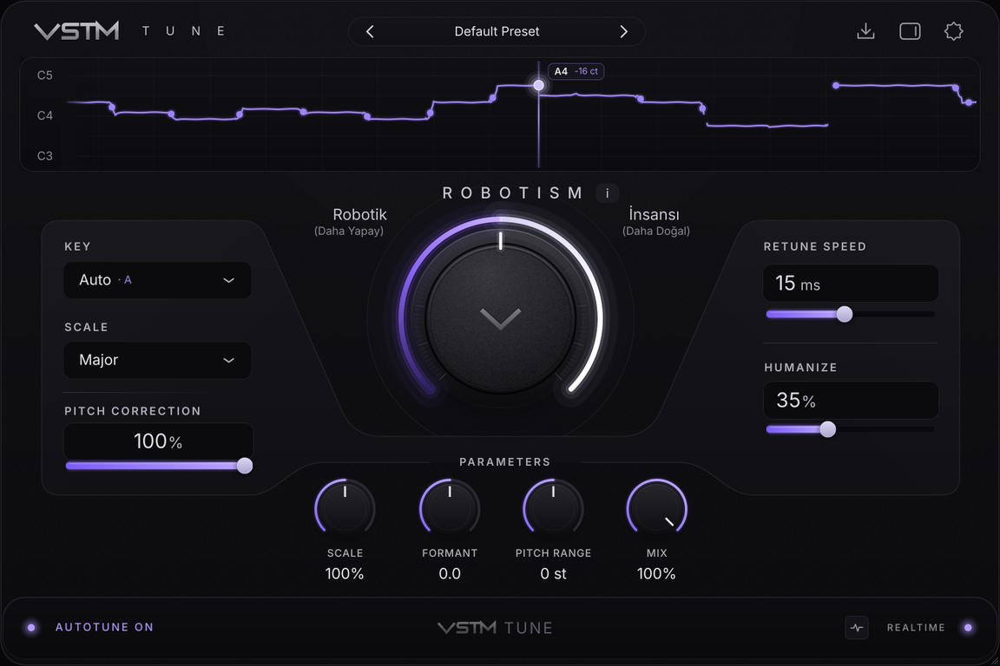
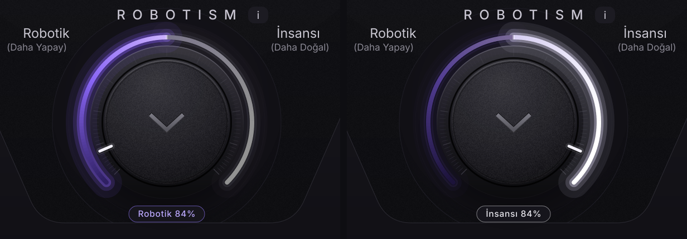

# VSTM Tune – gerçek zamanlı vokal autotune

Tek düğmeyle **robotik ↔ insansı** arasında gezinen, gerçek zamanlı perde düzeltme plugin'i.
Formatlar: **VST3**, **AU** (yalnız macOS), **Standalone**. Mono ve stereo.



## ROBOTISM düğmesi

| Yön | Ne olur |
|---|---|
| ◀ **Robotik** (Daha Yapay) | Düzeltme anında olur (retune → 0), notalar basamak gibi oturur, vibrato dümdüz olur, nota değişim eşiği küçülür. Klasik "robotik autotune" efekti. |
| **Ortada** (Dengeli) | RETUNE SPEED, HUMANIZE ve PITCH CORRECTION ayarları olduğu gibi uygulanır. |
| ▶ **İnsansı** (Daha Doğal) | Retune 4 katına kadar yavaşlar, notalar arası geçiş **S-eğrisiyle kayar** (en fazla 110 ms), cümle başındaki doğal "kayış" serbest kalır, uzun notalarda humanize artar. Düzeltme duyulmaz, ses insan gibi kalır. |

Düğmenin sol yayı (mor) robotik, sağ yayı (beyaz) insansı bölgedir; işaretçi hangi tarafa dönükse o taraf parlar.
Üzerine gelince altında değer yazar: `Robotik 40%`, `Dengeli`, `İnsansı 60%`. "i" düğmesi açıklamayı gösterir.



Testle ölçülen davranış (48 kHz, sentetik vokal, A3 → C4 sıçraması, ±50 cent vibrato):

| | Robotik (0) | İnsansı (100) |
|---|---|---|
| Nota geçiş süresi (%10 → %90) | 16 ms (basamak) | ~210 ms (kayarak) |
| Vibrato (tepe–tepe) | 1 cent (dümdüz) | 98 cent (korunur) |

**Eğri kalibrasyonu (dört ses tipi: bas, tenor, alto, soprano – sentetik, MEASURED):** düğme artık her
adımda benzer oranda değişir. Robotik uçtaki %0–10 "ölü bölge" kalktı (vibratonun %1'i → %4,5'i kalır),
%50 → %65 arasındaki ani sıçrama yumuşadı (tenor geçişi: %50 22 ms · %65 48 · %80 98 · %90 142 · %100 214 ms;
önce 22 · 76 · 124 · 160 · 214). %0, %50 (ayarlar olduğu gibi) ve %100 değişmedi. Tenor, alto ve soprano aynı
düğme değerinde ±5 puan içinde aynı vibrato miktarını bırakır. Gerçek vokallerde (91 kayıt) çıkışın en yakın
yarım sese uzaklığı %0'da ~2 ct, %50'de ~18 ct, %65 ve üstünde ~22–24 ct (doğal şarkı sapması); kadın, erkek ve rap
vokali gruplarında aynı sırayı izler. Algısal kalibrasyon (insan dinlemesi) henüz yapılmadı.

## Kontroller

| Kontrol | Açıklama |
|---|---|
| **KEY** | Tonik. **Auto**: şarkıyı dinleyip tonu kendisi bulur ve ne kadar emin olduğunu gösterir: `Auto · A` (emin), `Auto · A?` (henüz emin değil ya da şarkı tondan çıktı), `Auto · …` (dinliyor). Ton kilitlenene kadar en yakın yarım sese düzeltir. Tek nota ya da iki nota ton saymaz; aynı notaları paylaşan tonlar ayrılmadan karar vermez; modülasyonu ~1 s kararlılıkla izler, sessizlikte ve kromatik geçiş notalarında tonu değiştirmez. |
| **SCALE** | İzinli notalar: Chromatic, Major, Minor, Harmonic / Melodic Minor, Major / Minor Pentatonic, Blues, Dorian, Phrygian, Lydian, Mixolydian, **Hicaz**, **Özel dizi** (menünün sonunda: `Custom scale…`). |
| **Özel dizi (Custom scale)** | Bir oktavlık klavyede 12 notayı tek tek aç / kapat. Notalar tona göre tutulur (1, b2 … 7): ton değişince ya da Auto yeni tonu bulunca dizi de onunla kayar; tonik halkayla gösterilir. İlk açılışta seçili dizinin notalarıyla başlar; `Diziden kopyala` istediğin an tekrar alır. Preset ve projeyle kaydedilir, otomasyona açıktır. |
| **PITCH CORRECTION** | Hedef notaya olan mesafenin ne kadarı düzeltilsin (0–100%). |
| **RETUNE SPEED** | Perdenin notaya çekilme hızı (0–200 ms). 0 ms = anında. |
| **HUMANIZE** | Uzun, tutulan notalarda düzeltmeyi gevşetir; kısa notalar sıkı kalır. |
| **SCALE** (alt sıra) | Doğal vibrato ve perde hareketinin derinliği (0–200%, 100% = söylendiği gibi). |
| **FORMANT** | Sesin rengini (gırtlak boyu) perdeyi değiştirmeden kaydırır (±12, yarım ses). |
| **PITCH RANGE** | Düzeltilmiş sesi ±12 yarım ses transpoze eder. Transpoze ve formant kullanılırken seviye kuru sese eşitlenir (aşağıya bak). |
| **MIX** | Orijinal ↔ düzeltilmiş ses karışımı. |
| **ADAPTIVE** (deneysel) | Kapalıyken motor eskisiyle aynı çıkışı verir. Açıkken performansa sabit sınırlar içinde uyum sağlar: algılayıcı emin değilken düzeltme en çok %50'ye iner, söylenen vibrato ve bilinçli kaymalar korunur (ROBOTISM %15'ten %50'ye doğru devreye girer; robotik uçta etkisi yok), hızlı koşularda notalar daha çabuk oturur. Hiçbir parametreyi değiştirmez. Varsayılan değildir: dinleme testi sonuçlanmadı. |
| **AUTOTUNE ON** | Aç / kapat. DAW'ın bypass düğmesiyle senkron; kapalıyken ses gecikmesi korunur (takır yok). |
| **REALTIME** | Açık: düşük gecikme (**20 ms**, kayıt / canlı için). Kapalı: yüksek kalite (**40 ms**, çok kalın sesler için). DAW gecikmeyi otomatik telafi eder. Çalarken değiştirilebilir: ses 5 ms kısılıp yeni gecikmeyle 5 ms'de geri açılır (sessizlik / tık yok, bulunan ton korunur). |
| 〰 düğmesi | Perde ekranında ham giriş perdesini de gösterir. |

**Perde ekranı:** dikey çizgi yazma kafasıdır, soldan sağa tarar (6 saniye). Mor eğri düzeltilmiş çıkış,
noktalar nota geçişleri. Kafadaki etiket o an söylenen notayı ve girişin o notadan sapmasını gösterir (`A4 −16 ct`).
Ses yokken ekran durur (gereksiz CPU yok).

**Üst bar:** preset seçici (`<` `>` veya isme tıkla: 14 fabrika preseti + kendi presetlerin; değiştirince isim yanında nokta çıkar),
⤓ preset kaydet, ▢ pencere boyutu (768 × 512 … 1536 × 1024, köşeden de sürüklenir), ⚙ ayarlar (vokal aralığı:
Soprano / Alto, Tenor, Bas / Bariton; tüm parametreleri sıfırla; hakkında).

**Dil:** arayüz, bilgisayarın dilinde açılır: Türkçe, İngilizce, Almanca, Fransızca, İtalyanca, Rusça veya Çince.
Bunlardan biri değilse İngilizce. Düğme adları, değer yazıları, menüler, ipuçları ve DAW'da görünen parametre adları çevrilir;
preset ve nota adları (C, D, E…) değişmez. Kayıtlı projeler, otomasyonlar ve presetler dilden bağımsızdır (parametre kimlikleri aynı).
Dili zorlamak için ortam değişkeni: `VSTM_TUNE_LANG=de` (en, tr, de, fr, it, ru, zh).

**Fare:** düğmelerde dikey sürükle, **Shift** = ince ayar, **çift tık** = varsayılan, tekerlek, **değere tıkla** = yazarak gir,
**sağ tık** = DAW'ın parametre menüsü (otomasyon, MIDI learn).

Kullanıcı presetleri: `<kullanıcı veri klasörü>/VSTM Audio/VSTM Tune/Presets/*.vstmpreset`
(Windows: `%APPDATA%`, macOS: `~/Library`, Linux: `~/.config`).

## Nasıl çalışır

```
giriş ─► alçak geçiren + seyreltme (~11 kHz) ─► YIN perde algılayıcı (tam hızda alt-örnek ince ayar)
                                                   │
                         otomatik ton bulucu ◄─────┤
                                                   ▼
                                       düzeltme mantığı (key/scale, retune, humanize, ROBOTISM)
                                                   │
perde işaretleri (her periyotta bir, dalga benzerliğiyle hizalı)
            └──────────────────────────► TD-PSOLA sentez (formant korumalı, istenirse formant kaydırma)
                                                   │
giriş (gecikmeli, "dry") ─────────────────────► MIX / bypass ─► çıkış
```

- Düzeltme sesin kendi periyoduna göre yapılır: hard-tune'da çıkış hedef notada **0.05 cent'ten** daha az hata verir.
- **Oktav kararı tam hızda verilir:** perdenin P mi 2P mi olduğu, seyreltilmiş YIN eğrisiyle değil tam hızdaki sinyalin
  periyodikliğiyle seçilir. Eskiden legato bir yukarı oktav sıçramasında (soprano A4 → A5) algılayıcı notanın tamamında bir
  oktav aşağıda kalıyor, çıkışa f0/2'de −45 dB'lik bir alt oktav ekleniyordu; şimdi f0/2 kuru sesle aynı düzeyde (−78 dB).
  Gerçek vokallerde (145 kayıt) oktav hatası %0,81 → %0,21, ≥ 30 ms süren hatalı bölümler 44 → 16. Tam hız ince ayarı
  artık kaba tahminin dışına çıkan perdeyi de izler: Bass aralığında vibrato tahmini 4 kat pürüzsüz, hızlı bir geçişte
  hard-tune artık aradaki notada takılmaz (sentetik ±100 ct vibratoda izleme hatası 16–23 ct → 1–2 ct).
- **Transpoze ve formant seviyesi dengeli:** TD-PSOLA kaydırmayla seviyeyi değiştirir (oktav yukarı: −2…−9 dB, oktav aşağı /
  formant yukarı: +1,9 dB). Transpoze ya da formant kullanılırken kaydırılmış ses kuru sesin gücüne eşitlenir; yalnız saf
  ünlülerde ölçülür, ünsüz / nefes / sessizlik yükseltilmez, yukarı kaydırmada kısa tanecik patlamaları kuru sesin +4 dB
  üstüne çıkamaz. 50 gerçek kayıtta 18 ayarın hepsinde her dosya ±0,9 dB içinde (önce −7,9 / +2,4 dB'ye kadar); 145 kayıtta
  ±12 transpoze / formant'ta 145 dosyanın 144'ü ±1 dB içinde (aşan: konuşma ve vocal fry, en çok 1,3 dB).
  Transpoze ve formant 0 iken çıkış bit bit eskisiyle aynıdır. Yan etkiler için bkz. Bilinen sınırlar.
- **Nota seçimi titremez:** yeni nota ancak histerezisi (15 cent, İnsansı'da 35 cent) geçip kısa bir süre kararlı kalınca
  seçilir (Robotik 14 ms, Dengeli 22 ms, İnsansı 52 ms); sesin yeni notaya açıkça vardığı sıçramalarda (≥ 1.5 yarım ses) hemen.
  İki notanın tam ortasında söylenen seste hedefin her 3–10 ms'de bir gidip gelmesi ("trill") böylece önlenir:
  gerçek vokallerde 40 ms'den kısa nota bölümleri 3–10 kat azaldı.
- **Hece başlarında "güm" yok:** ünsüzden ünlüye geçişte (unvoiced → voiced) zamana hizalı unvoiced akış 4 ms daha
  sürer ve perdeye senkron voiced akışla çapraz geçiş yapar. Eskiden iki tanecik türü arka arkaya dikiliyordu;
  ünlünün ilk periyodu %50–70 seviyeye düşüyor, yarım kalan glottal darbe alçak frekanslı bir tık yapıyordu.
  Ölçüm (6 gerçek vokal, 540 geçiş): bu geçişlerdeki tık medyanı düzeltme modlarında 12–19 dB düştü,
  −45 dBFS'i aşan tıklar yarıya indi (40 → 22).
- Düzeltme 0 iken plugin şeffaftır (çıkış = giriş, 61 dB SNR) ve dry sinyalle örneğine kadar hizalıdır; MIX'te faz kayması olmaz.
- Motor blok boyutundan bağımsızdır (64 veya 1013 örneklik bloklar bit-bit aynı çıkışı verir), ses iş parçacığında kilit / bellek ayırma yoktur.
- **Bozuk veriye karşı korumalı:** girişteki NaN / Inf örnekleri (bozuk bir önceki plugin) sessizliğe çevrilir, düzeltme
  hemen kaldığı yerden sürer. Oturum veya preset dosyasındaki `nan` / `inf` değerler parametrenin varsayılanına döner;
  motor sayı olmayan bir parametre değerinde son geçerli değeri kullanır. Normal seste çıkış bit-bit aynıdır.
- Arayüz 1536 × 1024'lük vektörel bir tuval üzerinde çizilir ve ölçeklenir (her boyutta ve HiDPI'da keskin);
  sabit katmanlar ekranın gerçek piksel ölçeğinde bir kez çizilip saklanır.

## Derleme

Gerekenler: **CMake 3.22+** ve bir C++17 derleyici (Linux bağımlılıkları için kök README'ye bak).

```bash
cd VSTM_Tune
cmake -B build -DCMAKE_BUILD_TYPE=Release
cmake --build build --config Release -j8
```

İlk derlemede JUCE 8.0.6 otomatik indirilir. Elinde JUCE varsa: `-DVSTM_JUCE_PATH=/yol/JUCE`.
Çıktılar `build/VSTMTune_artefacts/Release/` altında (`VST3/VSTM Tune.vst3`, `AU/VSTM Tune.component`, `Standalone/`).

**Hazır paketler:** GitHub → Actions → **"VSTM Tune derle"** → en üstteki çalışma → sayfanın altındaki *Artifacts*
(`VSTM-Tune-Windows`, `VSTM-Tune-macOS`, `VSTM-Tune-Linux`; kurulum talimatı paketin içindeki `KURULUM.txt`'de).

## Testler

```bash
cmake -B build -DVSTM_BUILD_TESTS=ON
cmake --build build --config Release
./build/VSTMTune_EngineTest                                  # ses motoru (44.1 / 48 / 96 kHz)
./build/VSTMTune_PluginTest_artefacts/Release/VSTMTune_PluginTest goruntuler --vst3 "build/VSTMTune_artefacts/Release/VST3/VSTM Tune.vst3"
```

- **EngineTest:** hard-tune doğruluğu, seviye, şeffaflık + gecikme hizası, ±12 / +7 transpoze, formant, blok boyutu
  bağımsızlığı, ünlü başlangıcında genlik çukuru olmaması, Robotik / İnsansı geçiş süresi ve vibrato, iki nota
  arasında nota titremesi olmaması, otomatik ton (C majör) ve güveni (tek / iki nota, A minör, modülasyon, geçiş notaları),
  legato oktav sıçramaları, transpoze / formant seviyesi, özel dizi + Auto, Adaptive, sessizlik.
- **Gerçek vokal matrisi:** `tests/run_vocal_matrix.py` bir manifestteki kayıtları her ayarla WavProbe'dan geçirir ve
  bağımsız referansa (pYIN + YIN, `tests/pitch_eval.py`) göre ölçer: oktav / kaba hata, voiced doğruluğu, seviye,
  LF patlamaları, kuru sesin üstüne çıkan patlamalar, hedef sapması; önceki sürümle yan yana tablo verir.
  `tests/robotism_sweep.py` ROBOTISM'i ses gruplarına göre tarar. Kayıtlar depoda değildir (lisans); manifest yol verir.
  ```bash
  python3 tests/run_vocal_matrix.py --manifest vokaller.json --probe build/VSTMTune_WavProbe --out sonuc \
          --settings hard,default,tr+12 --baseline eski/summary.json
  ```
- **DAW testi:** `daw_test/` – test sinyalleri, REAPER betiği, FL Studio adımları ve render'ları ölçen araç (README orada).
- **WavProbe + vocal_metrics.py:** gerçek bir kaydı motordan geçirir, her analiz adımını (voiced, perde, hedef nota)
  CSV'ye yazar ve ölçer: nota titremesi, çıkış–hedef sapması, cent dağılımı, 20–150 Hz patlamaları, seviye.
  ```bash
  ./build/VSTMTune_WavProbe vokal.wav cikis.wav --csv adimlar.csv key=-1 robotism=0 retune=0
  python3 tests/vocal_metrics.py vokal.wav cikis.wav --csv adimlar.csv
  ```
  Çıkış, motor gecikmesini korur ve sonuna gecikme kadar sessizlik eklenir (girişin sonu kesilmez).
  Yalnız PCM 16 / 24 / 32 bit ve 32-bit float WAV okunur; bozuk veya kısa chunk'lı dosyalar reddedilir.
- **AuditProbe:** `VSTM_TUNE_AUDIT.md` bölüm 6'daki ölçümleri (S1–S16) sentetik sinyallerle yeniden üretir:
  büyük sıçramalar, NaN / Inf, REALTIME geçişi, örnekleme hızları, blok boyutları, stereo, otomasyon stresi,
  CPU, 10 dakika, unvoiced, Auto key, formant / transpoze, MIX, ROBOTISM taraması, ROBOTISM'in bas / tenor / alto /
  soprano'da taraması (S16). Karar vermez, ölçer:
  ```bash
  ./build/VSTMTune_AuditProbe olcumler            # hepsi;  tek senaryo: ... olcumler S2 S3
  ```
- **PluginTest:** parametre varsayılanları ve yazıları, 7 dilin eksiksizliği ve diller arası değer okuma, gecikme bildirimi (20 / 40 ms), bypass, oturum kaydet / geri yükle,
  presetler, editör; `goruntuler/` klasörüne ekran görüntüleri (her dil için `07_lang_xx.png`); `--vst3` ile derlenmiş VST3'ü bir DAW gibi yükleyip sınar.

## Bilinen sınırlar

- Plugin imzasızdır: Windows "bilinmeyen yayıncı", macOS "doğrulanamadı" uyarısı verebilir (`KURULUM.txt`).
- Bu ortamda gerçek bir DAW içinde denenmedi (REAPER / FL Studio yok); derlenmiş VST3 JUCE'un VST3 host'uyla yüklenip
  test edildi. DAW testi için kit: `daw_test/README.md` (REAPER betiği de REAPER'da çalıştırılmadı).
- **Adaptive deneyseldir** ve hiçbir insan dinlemesiyle doğrulanmadı; özel dizi düzenleyicisinin açılır penceresi
  yalnız ekran görüntüsüyle (bileşen tek başına) denetlendi, DAW içinde açılışı denenmedi.
- Algılayıcı aralığın üstündeki notaları bir oktav aşağıda bulur: Tenor / Mid ≈ C6'ya (1,05 kHz), Soprano / Alto ≈ F6'ya
  (1,4 kHz) kadar. Daha yüksek notalar için Soprano / Alto seç.
- Bass aralığında çok hızlı (≤ 20 ms) küçük üçlü kaymalarda algılayıcı ~30 ms "voiced değil" der; çıkış o anda şarkıcının
  kendi kaymasını izler, İnsansı taraftaki S-eğrisi kayma oluşmaz (60 ms'lik kaymada olmuyor). Sentetik ölçüm.
- Ani biten cümlelerde çıkış, kuru sesin sönümünden 10–20 ms daha uzun sürebiliyor (düzeltme kapalıyken de). 3 dakikalık bir
  rap vokalinde, hard ayarda kuru sesin 6 dB üstüne çıkan 70 adet 10 ms karenin 70'i de cümle sonu / sönümde; yumuşak
  biten şarkı kayıtlarında (VocalSet) hiç yok. Ölçüldü, dinlenmedi; açık iş.
- Monofonik vokal içindir (akor / koro düzeltmez). Çok kalın bas seslerde REALTIME'ı kapat veya ⚙ → Vocal range → Bass.
- **Büyük transpozede düşük seviyeli alçak frekans:** düzeltme modlarında (Robotik / Dengeli / İnsansı) 20–150 Hz'de
  kalan enerji ≈ −47 dBFS'tir; geniş transpozede TD-PSOLA geçici bölgelerde hâlâ alçak frekanslı enerji üretir
  (−3 st ≈ −42 dBFS, −12 st ≈ −30 dBFS tepe). Düzeltme kapalıyken yoktur. Ölçülerek doğrulandı; insan kulağıyla
  değerlendirilmedi.
- **Büyük yukarı kaydırmada (≥ +6 st) tanecik patlamaları:** üst üste binen tanecikler 10–30 ms boyunca aynı faza gelip sesi
  kendi düzeyinin 10–16 dB üstüne çıkarabiliyor (seviye dengelemesi olmadan da). Dengeleme bunları 10 ms'lik pencerelerde
  kuru sesin +4 dB'si ile sınırlar ama kaldırmaz; tek tek örnek tepeleri bunu geçebilir. TD-PSOLA'nın yapısından.
- **Seviye dengelemesinin yan etkileri (yukarı transpoze / aşağı formant):** seviye geri geldiği için tepe de yükselir; sıcak
  kayıtlarda çıkış 0 dBFS'i geçebilir (145 kaydın 4–6'sında; eklentide limiter yok, gerekiyorsa arkasına limiter koy).
  Seviye eşitlenmiş ölçümde transpoze +12'de tepe kuyruğu (p95) +2,6 dB, formant −12'de +1,3 dB arttı; 20–150 Hz
  olayları %10–21 arttı, 10 ms patlamaların toplamı azaldı. Ölçüldü, dinlenmedi; paketler ve ayrıntı:
  `VSTM_TUNE_AUDIT.md` 16.2.
- **Bass aralığında çok geniş ve hızlı vibrato** (±150–200 ct, 6 Hz ve üstü): algılayıcı bazı anlarda bir yarım sesten fazla
  yanılabiliyor (sentetik ölçüm; ±100 ct'ye kadar sorun yok).

## Lisanslar

Arayüz yazı tipi **Inter** (SIL Open Font License 1.1) — `Resources/fonts/OFL-Inter.txt`.
